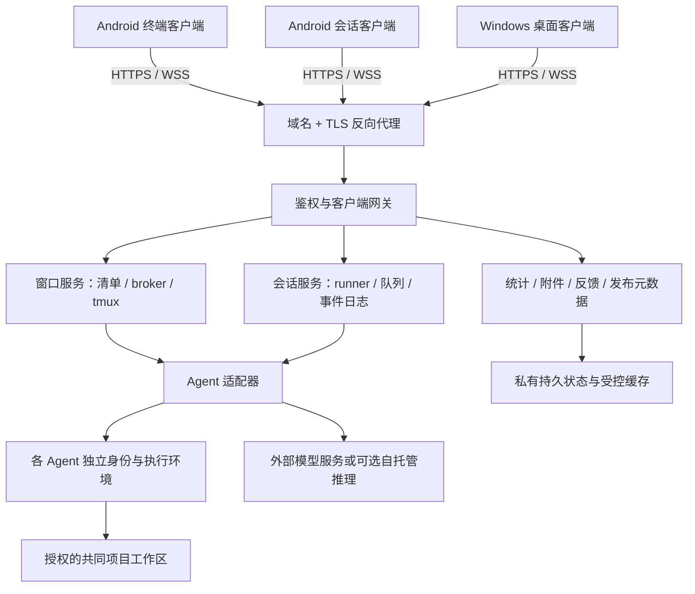

# 架构：让手机和电脑成为远程 Agent 的控制台

躺在床上看任务进度、用手机补一句要求、回到电脑接着工作：计算和文件留在 Linux 服务器，客户端负责显示、输入和确认。手机发现问题时，可以截图、写说明，把有限诊断提交给开发者，再交给有授权的 AI 协助定位和修复。

本仓库是一份独立重建蓝图。它公开设计方法和验收要求，不提供原系统源码、安装包、账户或部署参数。本文的名称、接口和目录布局均为新的通用示例。

## 三种入口，共用一套能力

| 入口 | 主要用途 | 服务端执行方式 |
|---|---|---|
| Android 终端客户端 | 操作已经存在的窗口，查看对话、原生终端和交互问题 | 专用 tmux 服务及各 Agent 的受限 broker |
| Android 会话客户端 | 聊天、排队、历史、审批、附件和控制面板 | 独立于网络连接的会话 runner |
| Windows 桌面客户端 | 用大屏管理窗口、会话、统计、附件和更新 | 鉴权网关复用前两类服务，不另造执行引擎 |

tmux 可以让终端程序在断开连接后继续运行，并供客户端重新附着；窗口、pane、会话和客户端是不同对象。实现时必须明确每次输入的目标。[tmux 官方入门](https://github.com/tmux/tmux/wiki/Getting-Started)

## 拓扑

公网只暴露 TLS 入口。Agent 原生 RPC、broker、模型密钥和维护 helper 留在服务器内，优先采用带操作系统身份校验的本地连接。Windows 网关必须限制允许的方法和路由，不能成为任意 URL 代理。

## 最低准备

- 一台可持续运行的 Linux 服务器：承载 API、tmux、存储和 Agent。容量按实际并发、Agent 子进程、附件和历史增长测量。
- 一个域名和可自动续期的 TLS 证书，以及能从手机、电脑访问的网络入口。
- Android 手机和 Windows 电脑。发布 Android 包需要 Flutter/Android 工具链；Windows 打包与原生验收需要 Windows 环境，可用独立构建 VM。
- 各模型服务的合法账户、订阅或 API 额度，由使用者另行准备和付费。服务器和域名不包含这些费用。

**仅做控制层不要求购买 GPU。** 可以连接外部服务；自行运行大模型是可选方案，需要另外核算显存、内存、磁盘、电力和模型许可，不能把普通控制服务器的预算当作大模型运行预算。

## 六个必须分开的概念

1. **窗口与会话**：关闭 pane 不等于删除会话；会话已持久化不等于仍有活跃进程。
2. **已接收与已执行**：上传成功、消息进入队列、Agent 开始处理和完成回答必须分别记录。
3. **配置与观测**：用户选择的模型、思考强度、上下文上限，与当前进程实际确认的值分别显示。
4. **上下文与累计 Tokens**：上下文占用是一次观测；累计用量是多次真实请求的账本。
5. **应用更新与 Agent 更新**：前者安装手机/电脑软件，后者变更服务器 Agent 工具；确认和结果各自独立。
6. **检查与关闭**：打开管理页或读取清单不调用模型、不停止窗口。分析和破坏性操作各有明确按钮。

## 隔离与共同工作区

每个 Agent 使用独立身份、凭据目录和持久状态。容器或 VM 的挂载仅包括其私有运行数据和明确授权的项目目录；不挂载其他 Agent 的 home、密钥、Docker socket 或整个宿主根目录。不要把同一个 Unix 用户下的多个目录误称为凭据隔离。

共同工作区允许各 Agent 添加和修改项目文件。进入其他私有环境需要独立授权，不因“能写共同目录”而获得权限。输入附件复制到受控命名空间，项目结果留在项目区；缓存清理只回收已证明可清理的私有副本。Docker 本身需要按权限、能力和宿主访问面配置安全边界。[Docker 安全文档](https://docs.docker.com/engine/security/)

可选协作桥只做有界任务路由、状态和租约，不替代隔离。总并发由一个共享准入器控制；例如为一种 Agent 设 16 路时，手机、电脑和桥共同消耗这 16 路，不能各自再开 16 路。

## 从哪里开始实现

先读 [接口与状态](contracts.md)，再按 [构建顺序](backend-build.md)做一个假 Agent 的完整闭环；之后接入 [真实适配器](agent-adapters.md)。开发中随时对照 [真实问题与经验](known-bugs.md)，最后执行 [验收矩阵](acceptance.md)。加入第五个模型的主要工作应当在适配器和能力目录，界面使用自适应布局，不依赖固定四个按钮。
