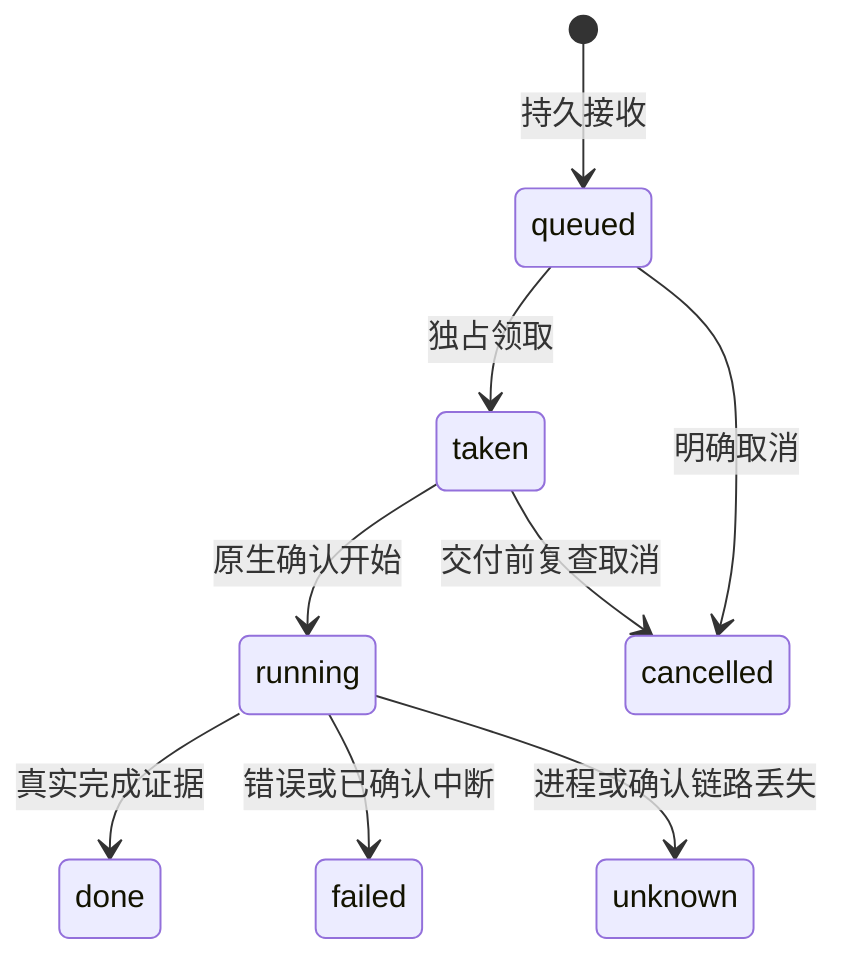

# 重建接口与状态契约

这是为独立实现设计的 `v1` 示例契约，不是原部署的接口清单。先用它生成 OpenAPI、JSON Schema 和测试，再写客户端。所有例子使用占位身份；服务端不接受客户端传来的主机命令、任意 URL 或文件系统路径。

## 1. 通用规则

JSON 使用 UTF-8；字节大小为整数，未知值为 `null`，布尔值不能充当整数。写接口拒绝未知字段、重复 JSON 键和非有限数。ID 使用服务生成的不透明值；客户端操作 UUID 为 32 位小写十六进制，必须在第一次写请求前持久保存。路径片段逐个校验，不能先拼路径再靠字符串前缀判断安全。

所有用户数据接口鉴权；只留不含内部信息的基础存活探针。访问令牌不可放 URL、日志或截图。HTTP 使用 Bearer，WebSocket 首帧认证且限制认证等待时间。令牌过期、登出和撤销均应失效；CORS 不是鉴权。

统一错误：`{code,message,request_id?,retry_after_seconds?}`。400/422 为输入不合法，401 为重新鉴权，409 为冲突或旧状态，413 为体积超限，423 为只读维护，429 为限流，503 为无法可靠服务，507 为存储不足。错误不暴露私有路径、原始 stderr 或凭据。**404 回执不存在表示未知，不证明上一次写请求没有执行。**

## 2. 路由总表

下表中的 `p` 是已启用 provider，`s` 是会话，`w` 是受控窗口。未启用 provider 明确拒绝，不回落到默认模型。

| 方法与示例路由 | 输入/输出核心 | 副作用 |
|---|---|---|
| POST `/v1/auth/session` | 操作者登录 → 有期令牌 | 建立本地访问会话，不登录模型账户 |
| GET `/v1/providers` | 能力、模型目录、服务可用性 | 只读 |
| GET `/v1/providers/{p}/sessions` | 分页、活动与来源 | 只读 |
| POST `/v1/providers/{p}/sessions` | `create_id,workspace_id` → `session_id` | 幂等建立逻辑会话 |
| GET `/v1/sessions/{s}/history` | `cursor,limit` → 有界页 | 只读 |
| GET `/v1/sessions/{s}/events` | `journal_id,since_seq,limit` | 补读缺失事件 |
| POST `/v1/sessions/{s}/messages` | 下述消息对象 → 原回执 | 接收一次逻辑消息 |
| GET `/v1/sessions/{s}/messages/{uuid}` | 持久状态与终态证据 | 只读恢复 |
| POST `/v1/sessions/{s}/interrupt` | `request_id,turn_id` | 明确中断一个回合 |
| POST `/v1/sessions/{s}/cancel-queued` | `request_id,message_ids` | 取消列出的未交付消息 |
| GET `/v1/windows` | 窗口清单、来源、能力、状态 | 不启动/关闭窗口 |
| POST `/v1/windows/{w}/messages` | 同消息对象 | 经原生检查交付一次 |
| POST `/v1/windows/{w}/dialog-answer` | `request_id,dialog_id,fingerprint,decision_id` | 回答当前已验证问题 |
| POST `/v1/terminals/tickets` | `window_id,mode` → 一次性票据 | 授予一次短期观察/输入权限 |
| GET `/v1/usage` | `scope,provider,period` | 真实用量与完整性 |
| POST `/v1/feedback` | 有界截图、说明、白名单诊断、报告 UUID | 私有保存报告 |

删除会话、停止进程、归档、恢复和账户切换应另设独立预览与确认接口。不要把它们藏在 GET、刷新、分页或模型分析请求内。

## 3. 能力驱动界面

每个 provider 至少声明：

```json
{
  "id": "qwen", "enabled": true,
  "capabilities": {
    "files": true, "images": false, "history_replay": false,
    "reasoning_efforts": ["none", "low", "medium", "xhigh"],
    "context_choices": [32768, 65536, 131072, 262144],
    "quota": false, "agent_update": true, "archive_stop": false
  }
}
```

这是经过能力验证后才能发布的一个**示例配置**，不是所有 Qwen 服务的固有属性。模型 ID、思考档位、视觉、上下文和更新能力以具体适配器确认结果为准。对 Kimi 等未实现插件标记 `enabled:false, implementation_status:"planned"`。

配置读取返回 `configured`、`observed`、`observed_at`、`editable` 和原因。修改只能在 fresh idle、无排队/交付、无维护时接受；附带 `settings_revision` 防止旧界面覆盖新设置。未观测到实际值时返回 `observed:null`，不得把保存成功写成原生运行确认。上限仅允许不超过服务端已验证能力的选项；恢复连接时重新显式应用保存的设置。

## 4. 消息与事件

```json
{
  "request_id": "11111111111111111111111111111111",
  "text": "请检查附件中的示例数据",
  "file_ids": ["file_demo"], "image_ids": [],
  "selection": {"model_id": "catalog-model", "effort": "low"}
}
```

去重键包含授权范围、provider、逻辑会话和 UUID。记录规范化请求摘要；同 ID 相同请求返回原状态，不再执行，同 ID 不同内容返回409。新的空会话须用持久 `create_id` 建立，客户端把临时草稿原子迁移到正式 ID 后才交付；不要只在 WebSocket 内存里保留第一句话。

会话 runner 状态：



`taken` 不等于已执行。崩溃后能证明尚未交付的记录可以恢复为 queued；running/unknown 不自动重跑。用户决定重新执行时建立新操作，明确显示可能已发生的文件修改。终端交付另有 `accepted → sent → queued_in_agent → delivered → answered`，以及 blocked/failed/unknown；不能把一次 Enter 返回成功当作 Agent 接收。

事件信封：`{schema:1,journal_id,seq,session_id,type,item_id?,payload,replayed}`。服务端先持久化再广播；客户端按 journal+seq 去重，流式 item 按 item_id 更新。历史页、WS 和 HTTP 补读用同一个 reducer。日志换代明确给新 journal_id；过旧游标返回 resync_required。慢订阅者断开并补读，不能静默丢事件。replayed 帧不能重新触发审批、停止、账户切换或其他动作。

WebSocket 首帧包含 `auth,token,journal_id,since_seq`，完成认证后订阅。心跳、重连和只读补读可以自动运行；**失去写操作确认后，客户端默认只查原 UUID，不自动重放 POST**。去重是服务端防御，不是客户端无限重发的理由。若日后添加自动投递，必须先独立证明其持久去重和恢复边界。

## 5. 附件与回执

示例采用流式 raw 上传：POST `/v1/uploads/{file|image}`，固定头 `X-Upload-Request-Id`、编码后的显示文件名，主体为原始字节。也可用 multipart，但鉴权和总请求大小限制必须先于解析/spool。服务端计算 SHA-256；显示名不决定存储路径；普通文件不执行、不解压、不转成 image block。

新 v1 推荐边界：普通文件每件最多25 MiB；含普通文件的消息最多8件附件、合计最多100 MiB；纯图片消息最多16件、合计最多100 MiB。每张图片的上传上限按客户端通道明确公布，单件与合计限制同时执行，不直接沿用普通文件上限。这是新契约的有限预算，不表示原三个客户端的既有图片通道采用相同限额；原通道差异见[附件与缓存](attachments-cache.md)。

显示名最多240 UTF-8字节，拒绝控制符和目录分隔符，不静默截断。解析、写入、IPC chunk、CPU解码和RAM各自设有界限制。

回执：`{request_id,id,kind,name,bytes,sha256,mime,state,available,reusable}`，state为 pending/committed/aborted。GET `/v1/uploads/receipts/{uuid}` 只查原操作。客户端核对 UUID、类型、名称、大小、摘要、授权来源和 scope 后，才能把托盘标成可发送；失去 ack 的草稿保持原 ID 和私有副本。`file_ids` 与 `image_ids` 永远分开，原生图片能力不足时禁用视觉通道并说明普通文件引用不代表视觉理解。

## 6. 缓存保护

GET `/v1/cache` 返回：`{complete,bytes,limit_bytes,eligible_count,items}`。每项至少有 `id,kind,bytes,reusable,in_use,queue_refs,eligible,protected_reason`。不完整时 bytes可为null，所有写操作关闭。客户端再合并持久托盘、草稿、outbox和未确认UUID引用；损坏或缺失的本地引用清单同样关闭操作。

POST `/v1/cache/release` 和 `/v1/cache/cleanup` 接受精确 `{request_id,ids,confirmed:true}`，每次有界选择。release只取消复用保留；cleanup再次盘点，只回收无任何引用、已释放、未变更的私有缓存。推荐私有缓存预算1 GiB；满时只尝试有界 eligible 回收，仍满则拒绝上传。

queued/taken/running、未确认、可重试、托盘和活跃lease都保护。CLI DONE、文件年龄、网页断开不构成安全删除证据。共同项目的输入副本、原件、Agent新结果均不自动清理；其占用应单独显示，不能藏入“已释放空间”。

## 7. Token 与窗口统计

用量记录键包含 `provider,model,run_id,request_id`，真实每次上游调用只记一次；去重不能只靠客户端消息UUID，一个Agent回合可能调用模型多次。字段区分输入、输出、推理、缓存及总量。推理或缓存可能是总量的子集，不盲目相加。

返回 `requests,usage_known,usage_unknown,known_tokens,total_tokens,complete,source,timezone`。无请求时 total_tokens=0可成立；有未知请求时总量应标未知，展示“已知 Tokens”下界。上下文另返回 `used_tokens,capacity_tokens,observed_at`；新连接或容量变化清空旧观测，等待真实 native update。

窗口级、每日、周及服务器汇总保留同一去重规则与明确时区。独立 API 链路只能声称统计自身请求，未覆盖其他调用方要明确说未覆盖。订阅剩余比例/余额和 Token 用量是不同数据源；不提供额度的模型隐藏额度卡。

## 8. 更新的两套契约

**应用更新**：GET `/v1/releases/{android|windows-x64}/latest` → `{version,platform,artifact:{name,bytes,sha256,path}}`。path只能是同一源的固定下载路由，版本/名称/平台严格匹配。客户端明确检查、下载、取消、确认安装；下载流、完成后和启动安装前复核摘要/大小。旧latest返回409，不偷偷安装另一个版本。身份变化取消下载，重新检查；服务端撤销授权也应中断长下载。

**Agent 更新**：GET status；POST preview → `{preview_id,expires_at,before,candidate,scope,can_update,blocked_reason}`；明确确认后 POST update `{preview_id,request_id,confirmed:true}` →202 `{job_id,receipt_confirmed}`。GET jobs/{id} 和 requests/{uuid}读取原回执。preview和job绑定原授权范围、provider和版本；unknown/丢ack仅允许查原操作，不再POST。若绑定访问令牌，重新登录产生新令牌后不能保证读取旧回执，需有权限的人工核对。

作业状态 `accepted/building/verifying/activating/finished/failed/unknown`；在锁内重读终态，不能用旧快照覆盖已完成作业。只升级未来容器的 scope 必须叫 future_instances，明确现有窗口未改变。涉及现有运行时的变更要另外证明可排空、可回滚，并逐窗再次确认。

## 9. 检查、分析与停止

窗口清单必须含 `complete,uncovered,generated_at,items`。年龄/RSS不证明空闲；未知不能填0。数字分析仅接收不透明ID、provider、创建/历史时间、RSS、activity枚举和archivable布尔，不接收原对话、路径或命令。模型建议 `keep/review/unknown` 不能授予停止权限。

所有provider分组始终可见，缺失来源列入uncovered。分析器选择与清单范围独立；默认零选择。旧保存清单若缺少新provider，保留原回执并标不完整，要求用户明确重新扫描。关闭要 fresh preview、选择、归档及回读校验、再次确认和逐项身份复查；不支持关闭的provider保持只读。
