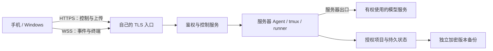

# 手机怎样连到服务器，服务器怎样连到模型

[返回总览](../README.md) · [文档阅读地图](repository-map.md) · [架构](architecture.md) · [备份与恢复](backup-recovery.md)

## 1. 先理解两段连接

手机和 Windows 客户端连接自己的控制服务器；模型请求由服务器上的 Agent 或适配器发送。客户端负责输入、看状态、传附件和确认，通常不需要直接连接每家模型服务，也不持有它们的 API 密钥。

这里的“手机只连服务器”指应用业务链路。系统联网、设备私网客户端的协调通信，以及服务器自己的 DNS、证书与维护通信，仍各有依赖。最小复建可采用一台有可达公网入口的服务器，不必先搭私网、打洞或 GPU 服务。

## 2. 参考实例实际采用过哪些软件

以下名称来自对现有客户端、部署文档和相关 Agent 报告的只读核对。它们说明参考实例采用过的组件与已实现入口；不表示读者设备已经配置，也不证明这些路径此刻实时可达。本次没有发起真实网络连通测试。

| 软件或服务 | 核对到的职责 | 与手机 Agent 的关系 |
| --- | --- | --- |
| Nginx | HTTPS 入口、固定后端反向代理、WebSocket 转发 | 常规客户端入口；内部服务留在回环地址或受控本地连接 |
| Tailscale | 已使用的设备私网与服务器间访问；两款 Android 应用有默认关闭的备用私网入口 | 可选的第二条到控制服务器的路径；也可用于控制服务器与独立推理服务器之间的连接 |
| WireGuard | Tailscale 数据通道使用的加密隧道机制 | 此处指 Tailscale 的底层机制，不表示另行部署了一套独立 WireGuard 服务 |
| OpenSSH | 服务器维护、受限远端访问及构建传输 | 运维通道；手机聊天不需要拿 SSH 密钥或取得任意 shell 权限 |
| rclone / SFTP | 相关报告中的授权远端文件读取与选定复制 | 数据扩展，不是打洞软件，也不是最小客户端的必需项 |
| Cloudflare | 参考实例使用过的公网代理 / DNS 服务 | 商业服务，可替换；不作为“开源打洞软件”列入必需依赖 |

Nginx 的 WebSocket 代理需要显式处理 `Upgrade` / `Connection` 和长连接超时；普通 HTTP 接口能访问，不代表 WSS 已配置正确。[Nginx 官方说明](https://nginx.org/en/docs/http/websocket.html)

Tailscale 会尝试 NAT 穿越建立设备间直连，也可以经 DERP 等中继；直连与中继的性能不同，不能承诺一定打洞成功或一定使用直连。官方资料说明其数据连接使用 WireGuard 加密。[连接类型](https://tailscale.com/docs/reference/connection-types) · [加密说明](https://tailscale.com/docs/concepts/tailscale-encryption)

OpenSSH 提供 SSH、SCP、SFTP 等远端操作工具；rclone 支持独立的数据传输用途。是否授权访问某个项目或存储，需要另外配置，不由“网络已经连通”决定。[OpenSSH 官方介绍](https://www.openssh.org/) · [rclone 文档](https://rclone.org/docs/)

### 源码许可与托管服务是两回事

| 对应源码 | 官方许可核对 | 范围 |
| --- | --- | --- |
| Nginx | [官方 LICENSE](https://github.com/nginx/nginx/blob/master/LICENSE)，BSD-2-Clause | 对应开源源码；不替商业产品授权 |
| Tailscale 客户端及其公开仓库 | [官方 LICENSE](https://github.com/tailscale/tailscale/blob/main/LICENSE)，BSD-3-Clause | 不表示官方托管控制服务全部开源或可原样自部署 |
| OpenSSH Portable | [官方 LICENCE](https://github.com/openssh/openssh-portable/blob/master/LICENCE)，多组件 BSD 风格等许可 | 按具体组件和发行包保留其声明 |
| rclone | [官方 COPYING](https://github.com/rclone/rclone/blob/master/COPYING)，MIT | 对应 rclone 源码，不替存储服务授权 |

Tailscale 的控制平面协调设备与策略，数据平面负责设备间通信；使用其开源客户端与使用官方托管服务不是同一许可或运营范围。[官方控制 / 数据平面说明](https://tailscale.com/docs/concepts/control-data-planes)

本蓝图的非商用许可不改变上述依赖的许可，也不为模型账户、商业服务或未收录软件重新授权。搭建时按实际版本核对，见[许可说明](licensing.md)。

## 3. 可选路线，不冒充已部署

| 方案 | 适合考虑的情况 | 本仓库证据范围 |
| --- | --- | --- |
| 直接公网 HTTPS / WSS | 自己的服务器已有可达公网入口 | 推荐最小路线；不用叠加打洞组件 |
| Tailscale 私网 | 手机与服务器可加入同一受控设备网络，需要备用入口或内网互访 | 参考实例采用过；新部署仍要验证设备、策略、路由和证书 |
| 独立 WireGuard | 希望自己管理隧道、密钥与路由 | 可选设计；本次未确认参考实例单独部署它。[官方项目](https://www.wireguard.com/) |
| frp | 自己的内网服务需要借助公网机器做反向代理 | 可选设计；本次未找到这套客户端链路已部署 frp 的证据。[官方概述](https://gofrp.org/en/docs/overview/) · [Apache-2.0 许可](https://github.com/fatedier/frp/blob/dev/LICENSE) |

frp 的 XTCP 是打洞方式之一，官方明确说明其成功受 NAT 类型影响，不能保证可用性与稳定性。[XTCP 官方说明](https://gofrp.org/en/docs/features/xtcp/)

这些路线不用全部安装。先证明一种到服务器的入口可靠，再按需要增加备用路径。选择其他控制平面、私网或反向隧道时，重新验收身份、访问策略、HTTPS/WSS、上传限制与回执恢复，不直接复用原部署参数。

## 4. 三段流量各自做什么

### 客户端 → 控制服务器

HTTPS 用于鉴权、能力目录、窗口 / 会话清单、原回执、附件及用户确认。WSS 传递事件、进度与终端视图。两者都需要身份校验、固定来源和大小预算；私网成员身份不能代替应用鉴权。

Tmux 客户端围绕服务器的原窗口和代次，Remote 客户端围绕持久逻辑会话与队列，Windows 网关复用受控能力。它们不把模型原生端口、broker、Docker socket 或凭据目录开放给手机。新接口字段与路由统一读 [v1 契约](contracts.md)。

### 控制服务器 → Agent → 模型

服务器验证目标与授权，再将一次已登记输入交给对应 Agent。模型 API 请求从服务器或独立推理服务器发送；所需订阅、账户、API 资格和额度仍必须有效。独立自托管推理也需要其机器、网络、资源和模型许可可用。

模型账本按真实请求、模型与运行标识记录；一个 Agent 回合可能产生多次上游请求。网络连接位置改变不意味着 Token 免费、额度共享或地区资格自动成立，详见[适配器](agent-adapters.md)。

### 运维与数据扩展

OpenSSH 可用于管理员维护自己的服务器；rclone / SFTP 可按授权读取或复制其他存储的选定数据。这些能力不是聊天接口默认授予的权限。第一次搭建不必复制报告中的远端设备、共享存储或多机拓扑。

## 5. 手机断网时，什么仍能继续

已被服务器持久接收、且已进入独立 runner 或原生 tmux 进程的任务，可以在手机断线后继续。客户端恢复后补读事件、确认原窗口 / 会话，并查询原请求状态；tmux 的 server、会话、窗口和客户端生命周期需要分别处理。[tmux 官方入门](https://github.com/tmux/tmux/wiki/Getting-Started)

| 情况 | 准确的解释 |
| --- | --- |
| 手机暂时断网，服务器与上游正常 | 服务器任务可能继续；手机暂时不能看新进度或发新指令 |
| 手机发送后丢失确认 | 不能断言已执行或未执行；先查原 UUID，不重放未知写入 |
| Agent 正等待用户批准 | 可能继续等待；断网不能自动替用户批准 |
| 服务器重启、磁盘故障或 Agent 退出 | 不由 tmux 或手机重连自动保证恢复；依据持久状态与恢复证据处理 |
| 服务器出口、上游身份或额度失效 | 服务器也不能正常请求模型；要显示明确失败 / 未知状态 |

对于手机网络不稳定或某些地区的访问差异，这种结构把持续执行和上游连接放在服务器端，减少任务依赖手机持续在线的程度。**手机仍须能到达自己的服务器，HTTPS/WSS 不能被阻断；服务器出口和上游服务资格也须可用。** 本项目不承诺任何网络、地区、运营商或模型服务必然可用，也不自动改变服务条款。

## 6. 私网备用入口的证书边界

参考实例的两款 Android 应用实现过私网备用直连；本次核对的备用入口代码仍对证书使用简化的主体与有效期判断，不能当作完整信任链和主机名验证。它默认关闭，并依赖已认证私网；这是参考实现的限制，不作为新蓝图的安全目标。

新实现应保留逻辑 HTTPS 主机名，正确处理 DNS、连接地址与 TLS 主机名，完整验证证书链及主机名；也可为私网服务配置适用的独立证书与受信来源。不得为“备用入口能连上”而接受任意证书。HTTP 与 WSS 两类连接都要验收，不能仅用一个命令行请求代替客户端实际握手。

## 7. 分层排错与安全恢复

1. 区分到服务器的网络错误、应用鉴权失效、WSS 升级失败和模型上游错误。
2. 保留本地草稿、附件快照及原 UUID；认证失败不产生隐藏发送或更新请求。
3. 恢复自己的已验证入口后，先读原窗口、事件和回执；切换网络不新建模型回合。
4. 仅查询自己的最小状态，不收集全网设备清单、真实地址、环境或凭据作为公开诊断。
5. 用模拟网络故障验证超时、断线、上传丢 ack、原回执恢复及零重复写入；真实路径只在明确授权的自有范围验收。

## 8. 连得上，也要能恢复数据

服务器集中保存项目、会话、回执和持久文件，存储故障或误删可能一次影响大量数据。手机缓存、同机另一目录、容器和 RAID 不能单独当作独立备份。

必要数据应有**服务器之外、加密、带历史版本**的备份，使用与 Agent 日常写入不同的权限，并定期在独立环境恢复演练。恢复历史请求时不自动重发未知操作。具体覆盖、频率、密钥与恢复验证见[备份与恢复](backup-recovery.md)。

## 9. 本页核验范围

软件职责来自参考实例源码 / 部署说明与已有报告；官方协议说明和许可在 2026-10-10 核对。公开内容只保留通用名称和职责，没有导出实际地址、设备身份、账号、运行配置或真实任务。当前实时连通性不在本次核验范围；读者须在自己的部署中测试。
