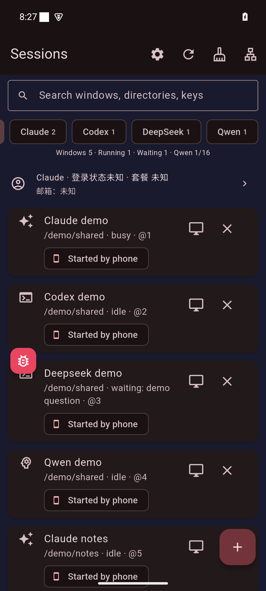
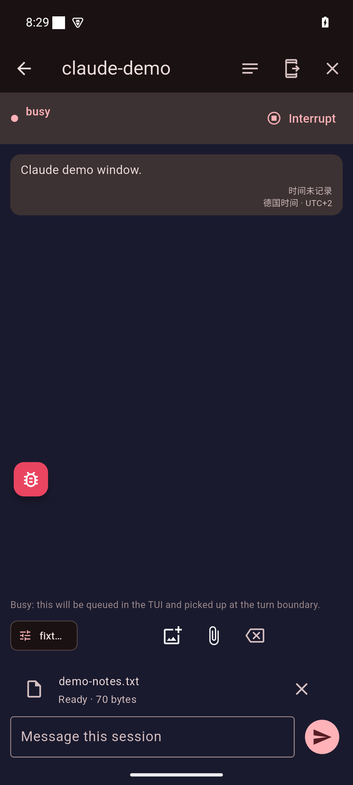
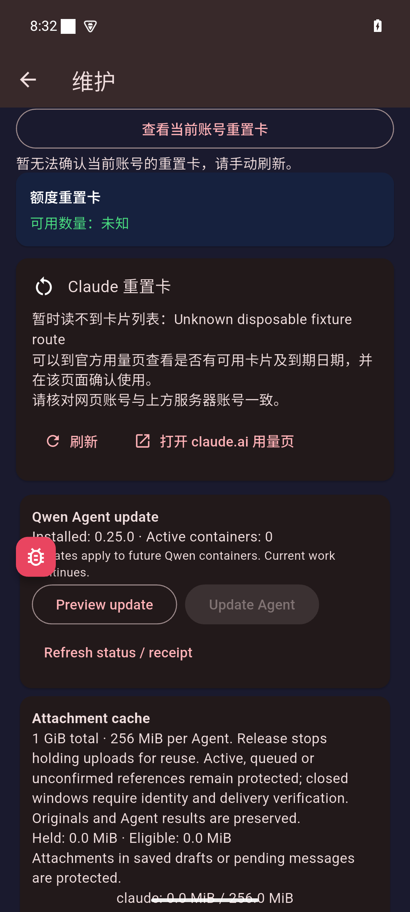
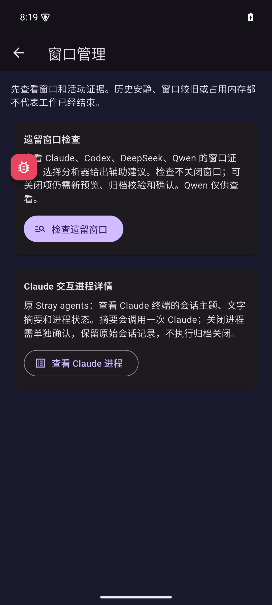
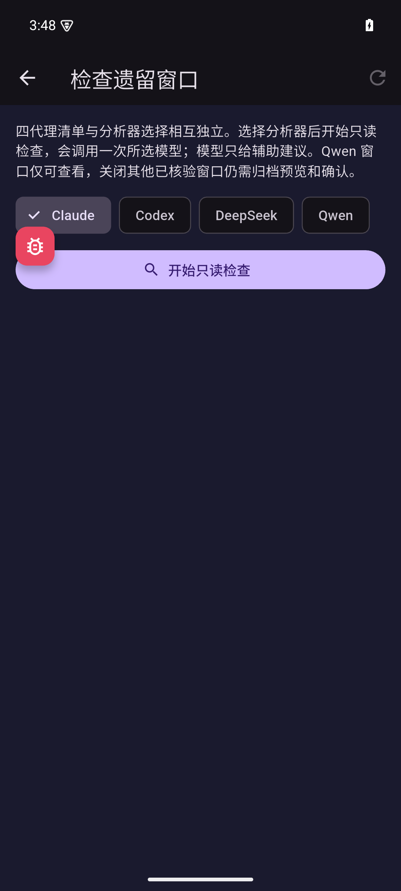
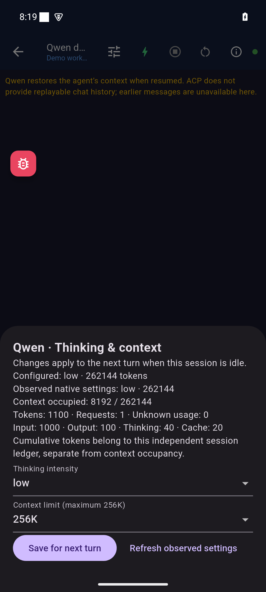
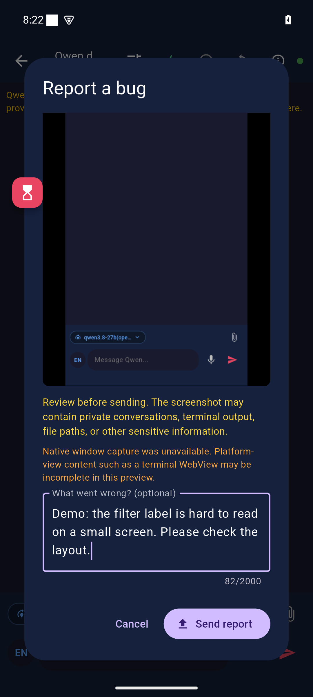
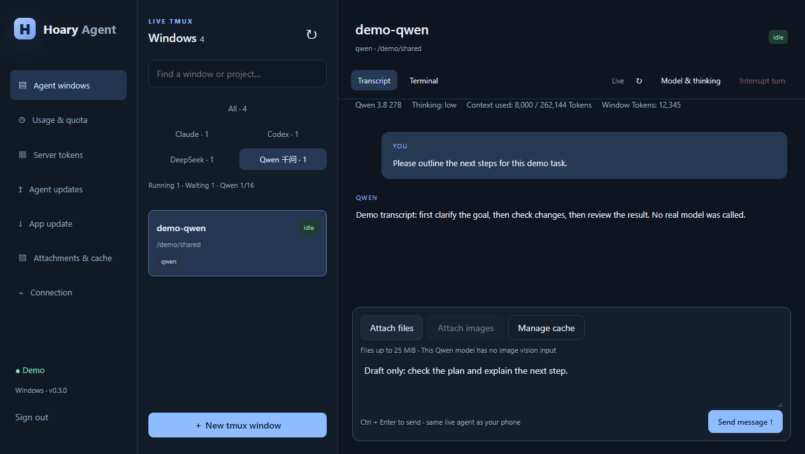
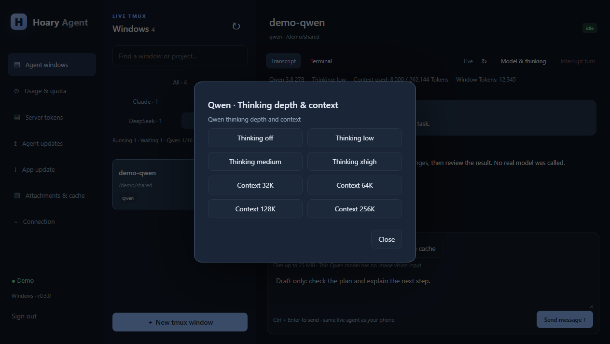
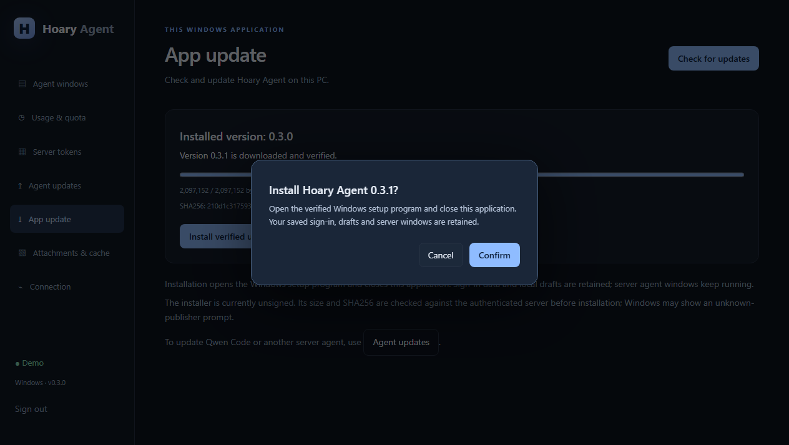

# Lazy Doggy：真实界面导览

这是 Lazy Doggy 蓝图所参考的三个客户端界面：Android Tmux 0.1.65、Android Remote 3.29.0 和 Windows 0.3.0。客户端原有品牌保留。

截图来自受控 Windows 11／Android 15 测试环境，窗口、路径、对话、用量和更新元数据使用合成演示数据。图片保留原始捕获字节，没有重绘或像素遮盖。Windows 界面仅在捕获时把账号显示替换为 Demo；此项在每张图的说明中标注。

## 手机 Tmux：筛选、附件和缓存

### 一行横向标签

真实 Tmux 0.1.65 客户端界面；合成演示数据。实际左右拖动后，四代理名称完整可见，窗口、运行、等待及 Qwen 16 路容量统计保留。滑动标签不启动任务。16 是原实例的准入上限展示，本次截图不构成并发性能测试。

### 普通文件附件栏

真实 Tmux 0.1.65 客户端界面；合成演示数据。通过 Android 系统文件选择器选中 demo-notes.txt，向演示服务上传一次70字节文件。Ready 表示已取得上传回执；文件仍在待发送附件栏，未发送模型任务，原文件保留。

### 缓存保护

真实 Tmux 0.1.65 客户端界面；合成演示数据。手动刷新后的缓存面板说明复用保留、活动租约、未知引用及本地草稿保护规则。本张展示策略和摘要区域，文件明细位于屏幕下方。上方账户卡片在测试替身中未配置，显示的通用提示不含真实路由或账号。本次不释放引用或清理文件。

## 手机 Remote：控制与反馈

### 窗口管理

真实 Remote 3.29.0 界面；合成演示数据。先区分遗留窗口检查和 Claude 交互进程详情。本次仅打开入口。

### 四代理检查入口

真实 Remote 3.29.0 界面；合成演示数据。复用该版本原生验收截图；四个分析器选项和 Qwen 只读说明可见。当前导览不执行检查任务或关闭窗口。

### 思考、上下文和 Token

真实 Remote 3.29.0 界面；合成演示数据。配置值、实际观测值、上下文占用和累计 Token 分别显示。数字用于说明字段含义。截图拍摄于更改前，显示 low／256K；之后仅向测试替身保存一次 xhigh／64K 设置，没有发送模型任务。

### 反馈草稿

真实 Remote 3.29.0 界面；合成演示数据。打开反馈预览、填写演示问题后选择 Cancel；没有发送报告或创建工单。界面提示分享前检查隐私，并如实显示当前截图捕获回退的限制。

## Windows：同一套服务的电脑入口

### 四代理与窗口

真实 Windows 0.3.0 客户端界面；合成演示数据；账号显示替换为 Demo。示例展示四代理筛选、Qwen 上下文占用和累计窗口 Token。输入框内容仅为未发送草稿。当前 Qwen 模型支持普通文件引用，界面明确标出图片视觉输入不可用。

### 思考深度与上下文

真实 Windows 0.3.0 客户端界面；合成演示数据；账号显示替换为 Demo。读取当前状态后打开控制菜单，展示思考深度和 32K～256K 上下文选项，随后关闭。

### 更新确认

真实 Windows 0.3.0 客户端界面；合成演示数据；账号显示替换为 Demo。0.3.1 是演示更新元数据：更新元数据、下载文件和摘要均由测试替身提供，未连接真实发布源；客户端核验合成文件的大小和 SHA256 后显示确认。选择 Cancel，未安装更新；正式客户端版本仍为 0.3.0。

## 使用这些图

[截图清单](../assets/screenshots/manifest.json) 提供客户端、标题、说明与替代文本。HTML 导览和离线文档使用同一套原始图片。业务用量、对话和窗口状态采用合成演示数据；系统状态栏显示测试环境信息。这些演示数字不用于表示真实账单或模型性能。

完整功能与实施约定见 [客户端](clients-build.md)、[附件与缓存](attachments-cache.md)、[更新与反馈](updates-feedback.md)。
